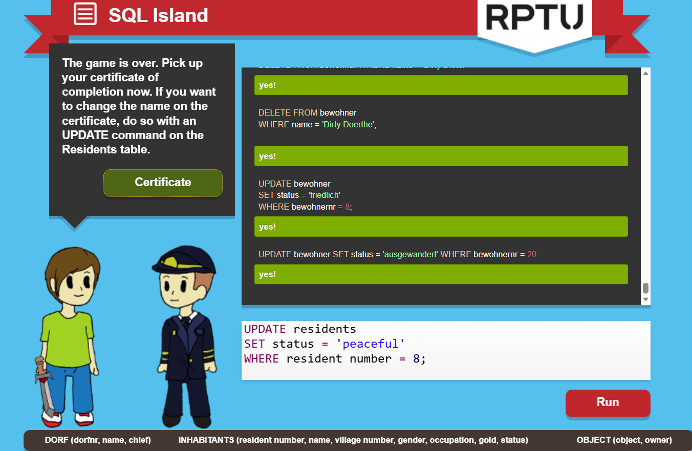

# SQL Island — Learning Reflection

## 1. What did I learn?

SQL Island helped me understand how a database can support a game.
The characters, their gold, professions, and items were stored as
data that we could query or change using SQL.

Before playing, I was not very familiar with SQL. Seeing the results
inside the game made its purpose clearer to me.

## 2. Which commands did I use?

The command I remember most is SELECT, which retrieves information.

With guidance, I also used:

- WHERE to find residents or items matching a condition.
- AND and OR to combine conditions.
- LIKE to match professions ending in a particular word.
- IS NULL to find items without an owner.
- ORDER BY to list the richest bakers first.
- UPDATE to change my character's name and transfer items.
- JOIN to connect residents with their villages.
- COUNT, SUM, and AVG to calculate totals and averages.
- GROUP BY to calculate average gold for each status.
- DELETE to remove a character's row during the story.

I followed these queries during the game, but I still need practice
writing them independently.

## 3. What are a table, row, column, and query?

Using the game as an example:

- A table stores related records, such as the residents.
- A row represents one record, such as one resident.
- A column holds one kind of information, such as a name or gold amount.
- A query asks the database for information, such as which residents
  are bakers.

## 4. What surprised me, and what needs more practice?

It was interesting to see how changing database values could change
what happened in the game, such as giving my character an item or
freeing the pilot.

One difficulty during the exercise was that the page displayed
translated English labels while the SQL used German names.
For example, inhabitants did not work as a table name, but bewohner did.

SELECT is the command I remember most clearly. I want to practise
the other commands so I can write queries with less help.

## Completion evidence

I completed SQL Island.

## AI assistance

I used AI when I need it.