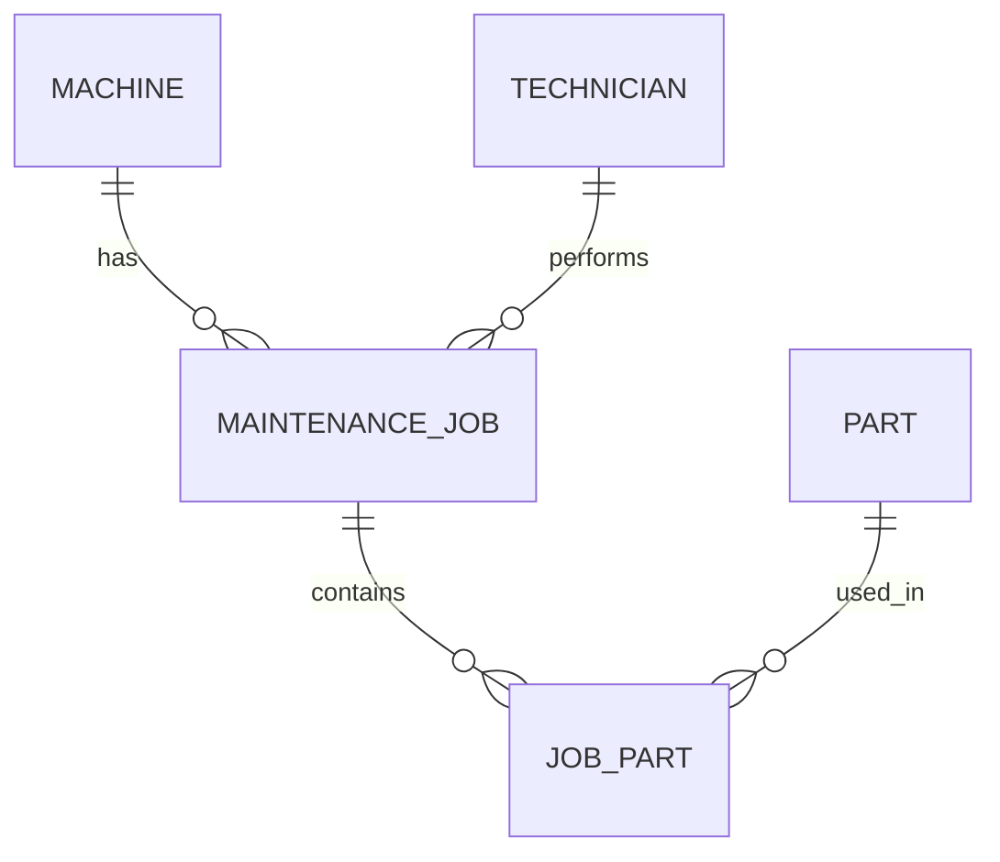

# Module 2 audit — what the legacy schema really says

## 1. Reconstructed ER model

### Entities and keys

| Entity | Important attributes | Intended key |
|---|---|---|
| Machine | name, serial number, site, installation date | `machine_name` in the old data; a new `machine_id` is safer |
| Part | part number, description, price | `part_no` |
| MaintenanceJob | job id, machine, technician, date, parts used | `job_id` |
| Technician | name | a separate entity is intended, although the old schema stores only text |

The old schema does not declare any primary keys or foreign keys. Therefore
these are intended keys, not enforced keys.



### Cardinalities

- One machine can have zero or many maintenance jobs.
- One technician can perform zero or many maintenance jobs.
- A maintenance job can use zero or many parts.
- A part can be used in zero or many maintenance jobs.

The first two relationships are stored only as text. The parts relationship
is hidden inside a comma-separated text list. That list is not a real
relationship because one column contains multiple values.

## 2. Defects proved with queries

Run the setup first:

```powershell
sqlite3 Module02/legacy.db ".read Module02/legacy_schema.sql"
```

### Defect 1 — orphan maintenance job

```sql
SELECT job_id, machine_name
FROM maint_job
WHERE machine_name NOT IN (SELECT machine_name FROM machine);
```

Expected result: `3 | cnc-05`.

**Impact:** job 3 cannot be connected to a real machine or site.

### Defect 2 — duplicate part number

```sql
SELECT part_no, COUNT(*) AS copies
FROM part
GROUP BY part_no
HAVING COUNT(*) > 1;
```

Expected result: `P-1003 | 2`.

**Impact:** a join can return the same part twice and totals can be doubled.

### Defect 3 — price stored as text

```sql
SELECT part_no, typeof(unit_price) AS stored_type, unit_price
FROM part;
```

Expected result: every `stored_type` is `text`, not a numeric type.

**Impact:** sorting and comparisons use text rules unless every query remembers
to cast the value; this can produce incorrect invoice totals.

### Defect 4 — invalid installation date

```sql
SELECT machine_name, installed
FROM machine
WHERE installed NOT GLOB
      '[0-9][0-9][0-9][0-9]-[0-9][0-9]-[0-9][0-9]';
```

Expected result: `RANDOM-NAME | unknown`.

**Impact:** date calculations and maintenance-age reports cannot trust every
row.

### Defect 5 — comma-separated parts lose data in a join

```sql
SELECT j.job_id, j.parts_used, p.part_no
FROM maint_job AS j
JOIN part AS p ON p.part_no = j.parts_used;
```

Expected results include jobs 2 and 3, but not job 1. Job 1 contains two
parts and therefore does not equal either single part number.

**Impact:** a report silently misses part usage for multi-part jobs.

## 3. Correct design

The corrected schema uses `machine_id`, `job_id`, and `part_no` as keys.
`job_part(job_id, part_no)` is the junction table for the many-to-many
relationship. This is the simple relational form of first normal form:
one field contains one value.

The database constraints belong in the database because every application
must obey them. Pydantic validation belongs at the application boundary
because it gives the user an immediate, readable error before an insert.

