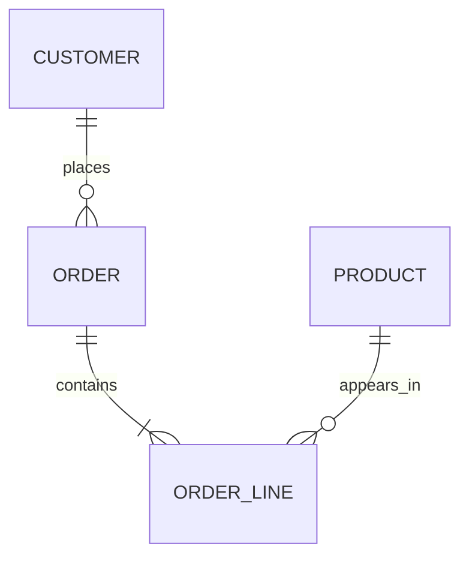
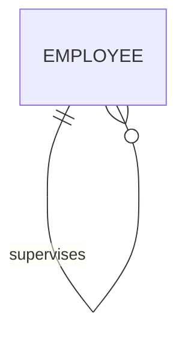
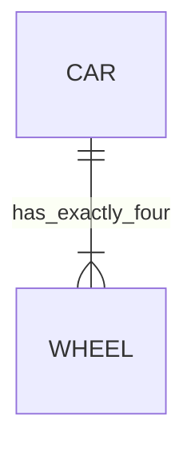
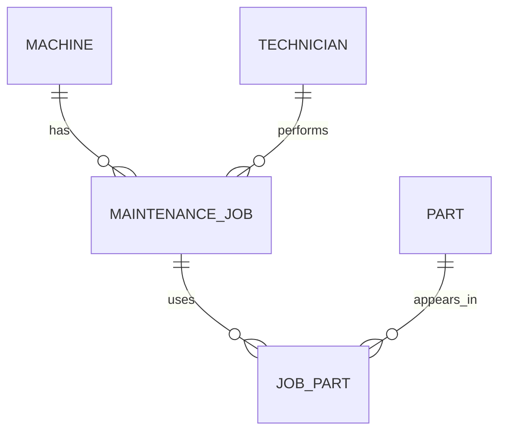

# Module 2 stretcher — Mermaid and inheritance

## 1. Three curated diagrams

### Good: associative entity

Source: [Mermaid ER diagram documentation](https://mermaid.js.org/syntax/entityRelationshipDiagram.html).



This is good because the associative entity stores the order/product pair and leaves no list-valued column.

### Strange: recursive relationship

Source: [Mermaid ER diagram documentation](https://mermaid.js.org/syntax/entityRelationshipDiagram.html).



This is valid but initially strange: both ends are the same entity. The role names are essential because they explain which employee is the supervisor and which is supervised.

### Wrong/confusing: unsupported exact cardinality



This is confusing because the notation says “one or more”, while the label claims exactly four. A spare wheel, trailer, or six-wheel vehicle breaks the assumption. The exact rule belongs in validation or a business constraint, not in a generic ER cardinality.

## 2. Schema-to-diagram round trip

The corrected schema in [contract.py](contract.py) produces this diagram:



The three database-enforced relationships are verified by the foreign keys in the contract. `Technician` is included in the conceptual model, but the current corrected schema stores its name as an attribute because the legacy data has no technician identifier. The round trip therefore exposed a useful distinction: a conceptual entity does not automatically mean the current database already has a separate table.

## 3. Inheritance alternatives

### Alternative A — one table with a discriminator

```sql
CREATE TABLE machine (
    machine_id INTEGER PRIMARY KEY,
    machine_type TEXT NOT NULL CHECK (machine_type IN ('cnc_mill', 'injection_molder')),
    serial_no TEXT NOT NULL UNIQUE,
    spindle_count INTEGER,
    clamp_force_kn INTEGER
);
```

`machine_type` identifies the subtype. `spindle_count` applies to CNC mills and `clamp_force_kn` applies to injection molders; application validation must reject irrelevant or missing subtype fields.

### Alternative B — separate subtype tables

```sql
CREATE TABLE machine (
    machine_id INTEGER PRIMARY KEY,
    serial_no TEXT NOT NULL UNIQUE
);

CREATE TABLE cnc_mill (
    machine_id INTEGER PRIMARY KEY REFERENCES machine(machine_id),
    spindle_count INTEGER NOT NULL
);

CREATE TABLE injection_molder (
    machine_id INTEGER PRIMARY KEY REFERENCES machine(machine_id),
    clamp_force_kn INTEGER NOT NULL
);
```

### Decision

I would ship the separate subtype tables when subtype attributes are important and different, because `NOT NULL` and foreign keys enforce the subtype data cleanly. I would use the discriminator table only when the subtypes are small and likely to change, because it is simpler but creates nullable columns and more application-level checks.

## 4. Cardinality and inheritance conclusions

Cardinality should describe relationship shape (`1:1`, `1:n`, or `m:n`); “exactly four” is usually a business rule that belongs in a check or application validation. Inheritance is useful when subtypes have stable, genuinely different attributes and rules. It is over-engineering when a single `type` value and a few shared columns express the domain more clearly; a large `Customer`/`Employee`/`Student` hierarchy can create many nullable fields and complicated joins.
