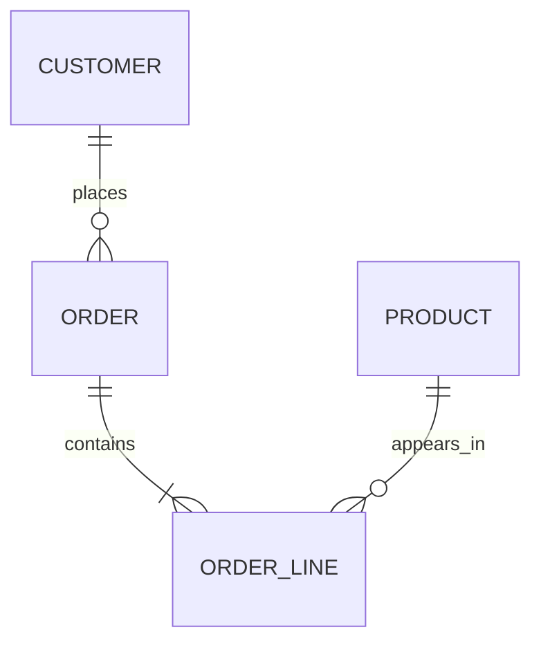
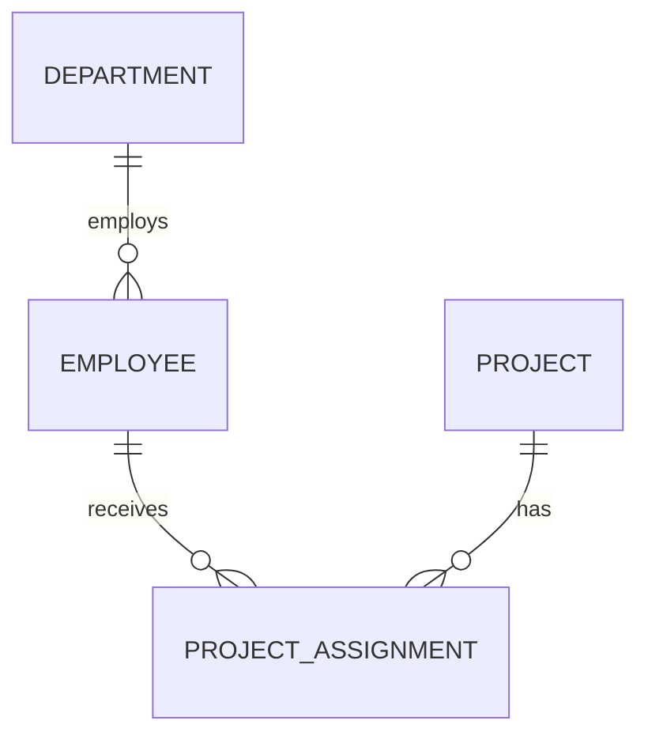
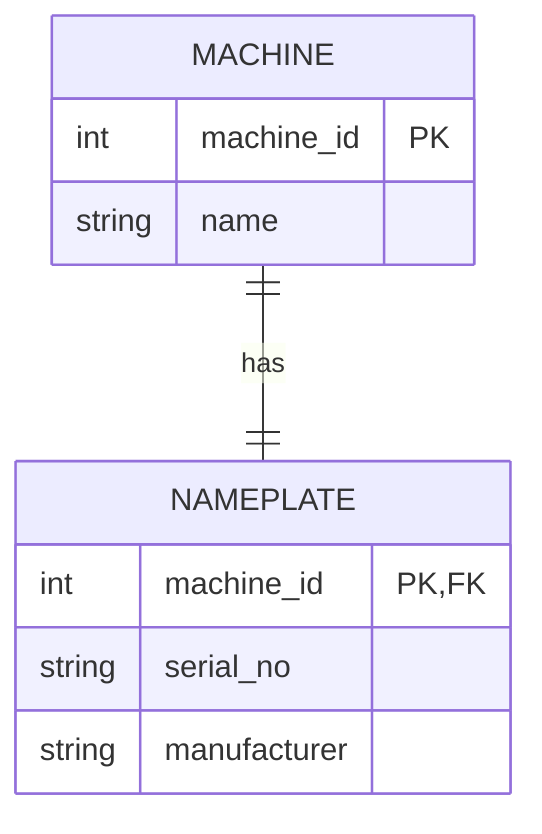
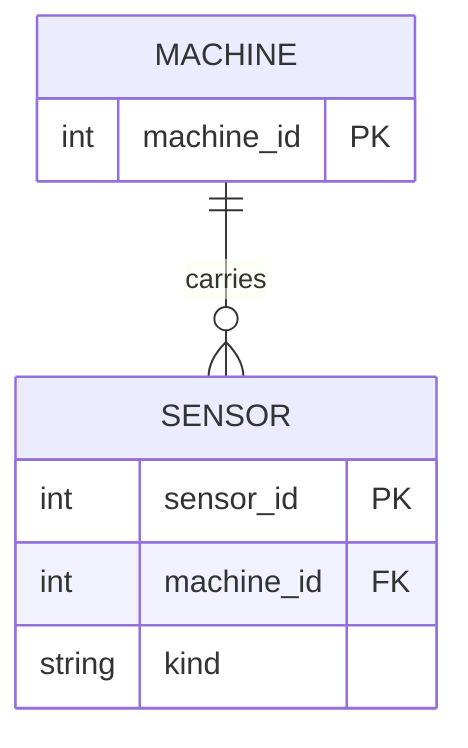
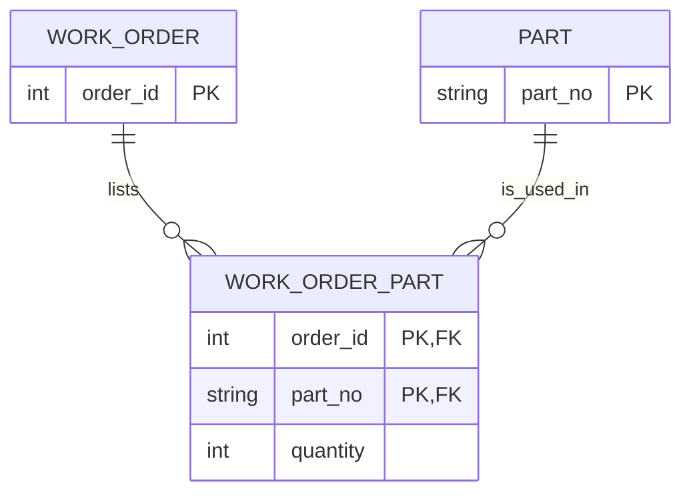
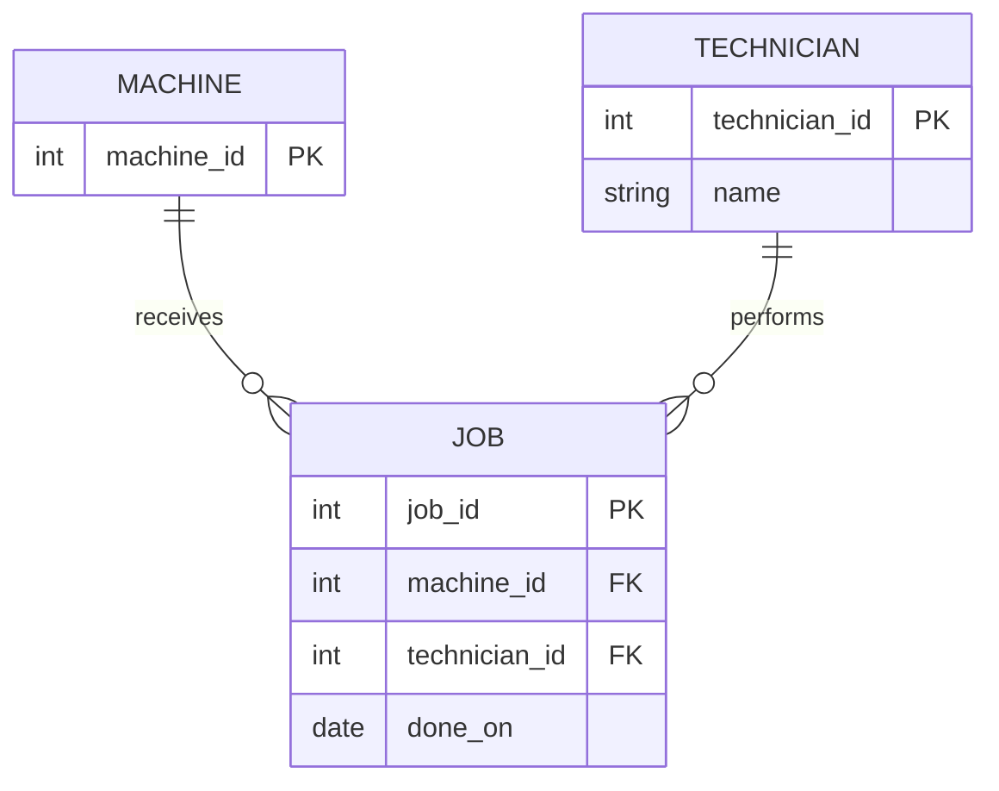

# Module 2 study log — Data contracts and legacy schemas

Author: John Dadzie

## 1. References used

| Reference | What it clarified |
|---|---|
| [Module 2 brief](../professors%20modules/modules/02-data-contracts-and-legacy-schemas.md) | An audit must separate what the legacy rows contain from what the repaired design should enforce. |
| [SQLite CREATE TABLE documentation](https://www.sqlite.org/lang_createtable.html) | A primary key, `UNIQUE`, `NOT NULL`, and foreign keys are different guarantees; naming a column does not enforce any of them. |
| [Mermaid ER diagram syntax](https://mermaid.js.org/syntax/entityRelationshipDiagram.html) | Crow's-foot symbols make optionality and cardinality explicit in a compact, reviewable diagram. |
| [Pydantic models](https://docs.pydantic.dev/latest/concepts/models/) | Application-boundary validation converts incoming values into typed fields or reports a readable validation error. |
| [SQLAlchemy Core tables](https://docs.sqlalchemy.org/en/20/core/metadata.html) | The database contract can be expressed as tables, columns, keys, constraints, and foreign keys before emitting DDL. |

## 2. Things I looked up

| Question | Finding and source |
|---|---|
| Why is `parts_used = 'P-1001,P-1002'` a problem? | It stores several values in one field, so the relationship cannot be joined or constrained as rows. This violates first normal form. Source: [SQLite query language](https://www.sqlite.org/lang.html). |
| What does a junction table solve? | `job_part(job_id, part_no)` represents each work-order/part pair once and uses a composite primary key to prevent duplicates. Source: [SQLAlchemy constraints](https://docs.sqlalchemy.org/en/20/core/constraints.html). |
| Is a technician an entity? | The old schema stores only a name, so it is currently an attribute. It becomes a separate entity when it has its own identity and attributes such as contact details or employment status. Source: [Mermaid ER diagrams](https://mermaid.js.org/syntax/entityRelationshipDiagram.html). |

## 3. Remarkable findings

- A column that looks like a key is not a key until the database enforces uniqueness.
- The legacy data has an orphan job even though every row looks syntactically valid.
- A text price can look numeric in a display while still being compared with text rules.
- Job 1 proves that the many-to-many relationship is hidden: it contains two parts in one value.

## 4. LLM Q&A and verification

### Prompt 1

**Prompt:** “Read this legacy schema and list the integrity defects, but do not assume any constraint that is not declared.”

**Answer summary:** The model identified missing keys and foreign keys, the duplicate `P-1003`, the invalid date, the orphan `cnc-05` job, and the comma-separated parts list. It also suggested replacing the list with a junction table.

**Verification:** I loaded [legacy_schema.sql](legacy_schema.sql) into SQLite and checked every claim with the five queries recorded in [er-audit.md](er-audit.md). The query results confirmed each defect.

### Prompt 2

**Prompt:** “Convert the corrected maintenance design to Mermaid ER syntax and state the cardinalities.”

**Answer summary:** The model produced `Machine`, `MaintenanceJob`, `Part`, and `JobPart`, with one-to-many links from machine/job and part/job, which together represent many-to-many part usage.

**Verification:** I compared each edge with the foreign keys in [contract.py](contract.py). I corrected the diagram to show `Technician` as a separate conceptual entity but noted that the old schema does not yet enforce that relationship.

### Prompt 3

**Prompt:** “What should Pydantic enforce and what should SQLAlchemy enforce?”

**Answer summary:** Pydantic should validate incoming values such as date types and the `SN-` format. The database should enforce keys, uniqueness, not-null requirements, numeric storage, and referential integrity for every application.

**Verification:** The final contract contains both kinds of rules. Running it with the project environment accepts a valid job, rejects an invalid machine, creates four tables, and emits the DDL in [contract-ddl.sql](contract-ddl.sql).

## 5. Two best ER sketches found and what they taught me

### Sketch A — Mermaid entity relationship example

Source: [Mermaid ER diagram documentation](https://mermaid.js.org/syntax/entityRelationshipDiagram.html).



This was the clearest example of an associative entity: `ORDER_LINE` turns the order/product many-to-many relationship into two one-to-many relationships.

### Sketch B — Crow's-foot notation example

Source: [Lucidchart ER diagram guide](https://www.lucidchart.com/pages/er-diagrams).



This example made optionality visible. A department may have no employees, while each assignment must belong to one employee and one project. That distinction helped me avoid drawing unsupported exact counts.

## 6. Task B — four sketches from plain language

### 6.1 One-to-one: machine and nameplate

The nameplate is a separate entity only if it has an independent lifecycle. For this wording, it is simplest as a one-to-one dependent table whose primary key is also a foreign key.



### 6.2 One-to-many: machine and sensors

The foreign key belongs on the many side, `SENSOR.machine_id`.



### 6.3 Many-to-many: work orders and parts

The extra table is `work_order_part`; its composite key is `(order_id, part_no)`, which prevents one order from listing a part twice.



### 6.4 Entity, attribute, and relationship: maintenance jobs

`JOB` is an entity because it has its own date and identifier. The job-to-machine and job-to-technician links are relationships. A technician is a separate entity when the system needs to identify and manage technicians, not merely display a name.



### Cardinality proof

This proof uses the machine/sensor example:

```sql
CREATE TABLE machine (machine_id INTEGER PRIMARY KEY);
CREATE TABLE sensor (
    sensor_id INTEGER PRIMARY KEY,
    machine_id INTEGER NOT NULL REFERENCES machine(machine_id)
);
INSERT INTO machine VALUES (1), (2);
INSERT INTO sensor VALUES (10, 1), (11, 1);
SELECT machine_id, COUNT(*) AS sensor_count
FROM sensor
GROUP BY machine_id;
```

Result:

```text
machine_id  sensor_count
1           2
```

This proves that one machine can have many sensors and that the foreign key is stored on the sensor side.

## Agreed learning (pod discussion)

1. A natural key without `PRIMARY KEY` or `UNIQUE` is only a candidate, not an enforced key.
2. A comma-separated list is not a relationship; a junction table is the reliable relational representation.
3. Cardinalities must describe the domain, while exact business counts belong in validation or checks.
4. An audit needs reproducible query results, not only a written list of suspected defects.

Open point: a technician can remain an attribute in a small system, but it should become an entity when technician-specific data or lifecycle rules are required.

## Shared image evidence

The rendered [Module 2 ER diagram](pictures/module02-er-diagram.svg) shows the
machine-to-job relationship and the `job_part` junction table that repairs the
hidden many-to-many relationship. The Mermaid source remains in
[er-audit.md](er-audit.md), so the image is reproducible and reviewable.
