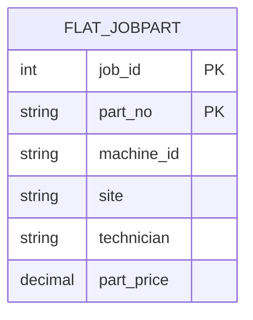
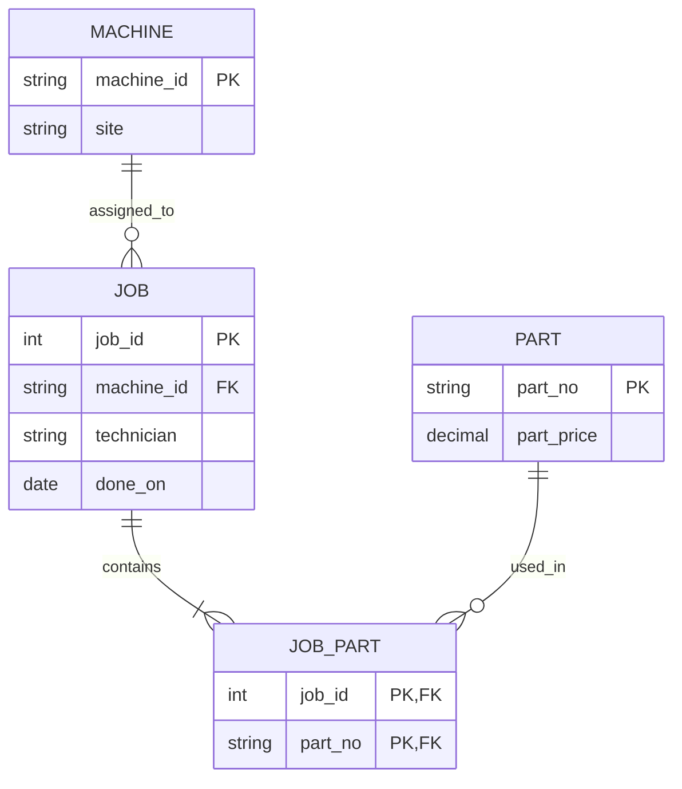

# Module 5 — Round 1: See It

## Purpose

This section records the Round 1 work: functional dependencies (FDs), their status as domain rules or observations in the sample, the candidate key, and two ER sketches. It is written so an instructor can see the assumptions and reasoning.

## Starting relation

`FlatJobPart(job_id, machine_id, site, technician, part_no, part_price)`

| job_id | machine_id | site | technician | part_no | part_price |
|---:|---|---|---|---|---:|
| 1 | cnc-01 | Gütersloh | tech-0 | P-0001 | 6.00 |
| 1 | cnc-01 | Gütersloh | tech-0 | P-0002 | 7.00 |
| 2 | cnc-02 | Gütersloh | tech-1 | P-0001 | 6.00 |
| 2 | cnc-02 | Gütersloh | tech-1 | P-0003 | 8.50 |
| 3 | cnc-01 | Gütersloh | tech-0 | P-0003 | 8.50 |

## Functional dependencies

An FD `X → Y` means that any two valid rows that agree on `X` must also agree on `Y`. Domain rules come from the meaning and rules of the data; a pattern seen in five sample rows alone does not establish a domain rule.

| FD | Classification | Explanation |
|---|---|---|
| `job_id → machine_id` | Domain rule (assumption) | A job is performed on one machine. |
| `job_id → technician` | Domain rule (assumption) | A job is assigned to one technician. If jobs can have multiple technicians, this rule and the proposed `job` table must change. |
| `machine_id → site` | Domain rule (assumption) | A machine belongs to one site at a time. If site history matters, the model needs effective dates or a history table. |
| `part_no → part_price` | Domain rule (assumption) | This module treats each part number as having one current price. If price varies over time or by purchase, price belongs on a purchase/job-part event instead. |
| `(job_id, part_no) → machine_id, site, technician, part_price` | Follows from the rules above | The pair identifies one job-part row; the other listed attributes follow from the dependencies above. |
| `site = Gütersloh` for all five shown rows | Sample observation only | All five rows show Gütersloh. The sample does not prove that all machines are at this site. |
| `technician → machine_id` | Sample observation only | In these rows, tech-0 appears with cnc-01 and tech-1 with cnc-02. The stated domain rules do not prevent a technician from working on several machines. |

The domain-rule FDs imply the transitive dependency `job_id → site` through `machine_id` (`job_id → machine_id → site`). The normalized design stores `site` with the machine it describes, rather than repeating it on every job-part row.

## Candidate key

The candidate key for `FlatJobPart` is **`(job_id, part_no)`**:

- It identifies a job-part row under the module's rule that a part appears at most once per job.
- `job_id` alone is not unique: job 1 has both P-0001 and P-0002.
- `part_no` alone is not unique: P-0001 appears in jobs 1 and 2.
- Therefore neither attribute can be removed from the pair while retaining uniqueness.

If a job can contain the same part number more than once as separate line items, add a `job_part_id` or `line_no` and use that as part of the key.

## ER sketch 1 — current flat representation

The flat representation stores all facts in one relation. The composite key is shown explicitly.

The two `PK` markers together denote the composite primary key `(job_id, part_no)`.

## ER sketch 2 — proposed normalized representation

The two `PK` markers on `JOB_PART` together denote the composite primary key `(job_id, part_no)`. Each job has one or more job-part rows; each job-part row refers to exactly one job and one part. `done_on` is included because it appears in the later Round 3 schema; it was not included in the six-column sample relation above.

`JOB_PART` is the associative entity for the many-to-many relationship between jobs and parts. Its primary key is `(job_id, part_no)`. The `done_on` attribute appears here because it is part of the later Round 3 schema; it was not included in the six-column extract above.

## What changes between the sketches?

The FDs do not stop being true in the normalized design. Their facts are stored with the entity they describe:

- `machine_id → site` is represented in `MACHINE`.
- `job_id → machine_id, technician` is represented in `JOB`.
- `part_no → part_price` is represented in `PART`.
- The association between each job and its parts is represented in `JOB_PART`.

In particular, the transitive path from `job_id` to `site` is no longer stored as a direct repeated attribute on each job-part row: it is reached through `JOB.machine_id → MACHINE.site`. This removes repeated copies and update anomalies; it does not invalidate the logical dependency `job_id → site` implied by the assumptions.

## Gate check

Ask a neighboring pod: **“Which arrow disappears in the second diagram?”**

Expected clarification: the direct stored/repeated `job_id → site` path disappears from the job-part record; site is reached through `machine_id` in `MACHINE`. Strictly speaking, the FD still follows transitively from the stated domain rules. The teacher can use this distinction to check whether students understand that normalization changes where facts are stored, not the underlying business rules.

## Assumptions to confirm

1. Each job has exactly one machine and one technician.
2. Each machine has one current site.
3. Each part number has one current price.
4. A part number occurs at most once in a job.

If any assumption is false, revise the FDs and keys before decomposing the table.

